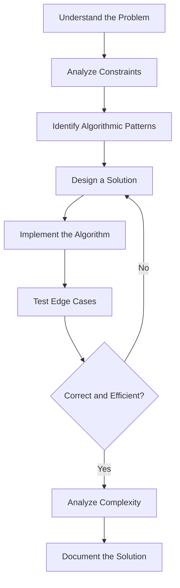

<div align="center">

# LeetCode Solutions


<br />


<br /><br />

[](https://developer.mozilla.org/en-US/docs/Web/JavaScript)
[](https://www.typescriptlang.org/)
[](https://www.rust-lang.org/)

[](https://leetcode.com/u/siliconvalleyman/)
[](https://github.com/siliconvalleyman)

[](https://github.com/siliconvalleyman/leetcode/stargazers)
[](https://github.com/siliconvalleyman/leetcode/network/members)


**A continuous journey through algorithms, data structures, and computational thinking.**

</div>

---

## Overview

This repository contains my personal collection of solutions to LeetCode problems implemented in **JavaScript, TypeScript, and Rust**.

It serves as a continuously evolving knowledge base dedicated to algorithmic problem solving, computer science fundamentals, performance optimization, and technical interview preparation.

Rather than simply solving problems, I focus on understanding the underlying principles, exploring alternative approaches, and developing efficient, reliable, and maintainable implementations.

## Table of Contents

- [Programming Languages](#programming-languages)
- [LeetCode Statistics](#leetcode-statistics)
- [Problem Difficulty](#problem-difficulty)
- [Topics Covered](#topics-covered)
- [Repository Structure](#repository-structure)
- [Problem-Solving Methodology](#problem-solving-methodology)
- [Complexity Analysis](#complexity-analysis)
- [Coding Standards](#coding-standards)
- [Learning Roadmap](#learning-roadmap)
- [Resources](#resources)
- [Author](#author)

## Programming Languages

<div align="center">

<table>
<tr>
<td align="center" width="33%">

<br /><br />
<strong>JavaScript</strong>
<br /><br />
Flexible and expressive solutions using modern ECMAScript features.
</td>
<td align="center" width="33%">

<br /><br />
<strong>TypeScript</strong>
<br /><br />
Type-safe, structured, and maintainable algorithm implementations.
</td>
<td align="center" width="33%">

<br /><br />
<strong>Rust</strong>
<br /><br />
Memory-safe, high-performance solutions with zero-cost abstractions.
</td>
</tr>
</table>

</div>

## LeetCode Statistics

<div align="center">

<a href="https://leetcode.com/u/siliconvalleyman/">

</a>

<br /><br />

[](https://leetcode.com/u/siliconvalleyman/)

</div>

## Problem Difficulty

| Difficulty | Description | Directory |
| :--- | :--- | :--- |
|  | Fundamental concepts and essential techniques | [Browse](./easy/) |
|  | Intermediate algorithms and problem-solving patterns | [Browse](./medium/) |
|  | Advanced algorithms and complex optimization | [Browse](./hard/) |

## Topics Covered

| Category | Concepts and Techniques |
| :--- | :--- |
| Arrays & Strings | Traversal, Two Pointers, Sliding Window, Prefix Sum |
| Hash Tables | HashMap, HashSet, Frequency Counting |
| Linked Lists | Reversal, Fast and Slow Pointers, Cycle Detection |
| Stacks & Queues | Monotonic Stack, Deque, Priority Queue |
| Sorting | Merge Sort, Quick Sort, Counting Sort |
| Searching | Binary Search, Binary Search on Answer |
| Trees | Binary Trees, BST, DFS, BFS, Trie |
| Graphs | Traversal, Shortest Paths, Topological Sort |
| Dynamic Programming | Memoization, Tabulation, State Optimization |
| Greedy Algorithms | Local Optimization, Interval Scheduling |
| Backtracking | Recursion, Permutations, Combinations |
| Heap | Min Heap, Max Heap, Top-K Problems |
| Bit Manipulation | Bitwise Operations, Bitmasking |
| Mathematics | Number Theory, Modular Arithmetic |
| Union Find | Disjoint Set Union, Path Compression |
| Advanced Structures | Segment Tree, Fenwick Tree |

## Repository Structure

Solutions are organized by problem difficulty and implemented in one or more supported programming languages.

```text
leetcode/
│
├── easy/
│   ├── ...
│   └── ...
│
├── medium/
│   ├── ...
│   └── ...
│
├── hard/
│   ├── ...
│   └── ...
│
└── README.md
```

### Supported File Extensions

| Extension | Language |
| :--- | :--- |
| `.js` | JavaScript |
| `.ts` | TypeScript |
| `.rs` | Rust |

## Problem-Solving Methodology

Every problem is approached systematically:



The objective is not only to find a working solution, but also to understand why it works and how it can be improved.

## Complexity Analysis

Each solution aims to balance execution efficiency, memory consumption, and code readability.

| Complexity | Classification | Typical Example |
| :--- | :--- | :--- |
| `O(1)` | Constant | Hash table lookup, average case |
| `O(log n)` | Logarithmic | Binary search |
| `O(n)` | Linear | Array traversal |
| `O(n log n)` | Linearithmic | Merge sort |
| `O(n²)` | Quadratic | Nested iterations |
| `O(n³)` | Cubic | Triple nested iterations |
| `O(2ⁿ)` | Exponential | Subset enumeration |
| `O(n!)` | Factorial | Permutation generation |

### Performance Principles

- Minimize unnecessary computations.
- Select appropriate data structures.
- Avoid redundant memory allocations.
- Optimize time and space complexity.
- Handle boundary conditions and edge cases.
- Prioritize correctness before optimization.

## Coding Standards

All implementations aim to follow professional software engineering practices.

### JavaScript

- Modern ECMAScript syntax.
- Descriptive variable and function names.
- Minimal dependencies.
- Clean and idiomatic implementations.

### TypeScript

- Explicit and meaningful types.
- Type-safe function signatures.
- Strict type checking.
- Predictable and maintainable code.

### Rust

- Ownership and borrowing principles.
- Memory safety without garbage collection.
- Idiomatic Rust implementations.
- Efficient use of iterators and collections.
- Minimal unnecessary cloning and allocations.
- Safe Rust whenever possible.

## Learning Roadmap

- [ ] Master arrays and strings.
- [ ] Master hashing and frequency counting.
- [ ] Master two pointers and sliding window.
- [ ] Master linked lists, stacks, and queues.
- [ ] Master binary search and sorting.
- [ ] Master trees and graph algorithms.
- [ ] Master recursion and backtracking.
- [ ] Master dynamic programming.
- [ ] Master greedy algorithms.
- [ ] Master advanced data structures.
- [ ] Develop advanced Rust programming skills.
- [ ] Solve 100 LeetCode problems.
- [ ] Solve 250 LeetCode problems.
- [ ] Solve 500 LeetCode problems.
- [ ] Solve 1,000 LeetCode problems.

## Development Tools

<div align="center">


</div>

## Resources

| Resource | Description |
| :--- | :--- |
| [LeetCode](https://leetcode.com/) | Algorithmic challenges and interview preparation |
| [MDN Web Docs](https://developer.mozilla.org/) | JavaScript documentation |
| [TypeScript Handbook](https://www.typescriptlang.org/docs/) | Official TypeScript documentation |
| [The Rust Programming Language](https://doc.rust-lang.org/book/) | Official Rust programming book |
| [Rust by Example](https://doc.rust-lang.org/rust-by-example/) | Practical Rust programming examples |
| [VisuAlgo](https://visualgo.net/) | Interactive algorithm visualizations |
| [CP-Algorithms](https://cp-algorithms.com/) | Algorithms and competitive programming |

## Author

<div align="center">

<a href="https://github.com/siliconvalleyman">

</a>

### Zavqiddin Hasanov

**Software Engineer | Full Stack Developer**

Passionate about software architecture, algorithms, systems programming, and continuous learning.

[](https://github.com/siliconvalleyman)

[](https://leetcode.com/u/siliconvalleyman/)


</div>

---

<div align="center">

**Think clearly. Code efficiently. Improve continuously.**

If you find this repository useful, consider giving it a star.


</div>
